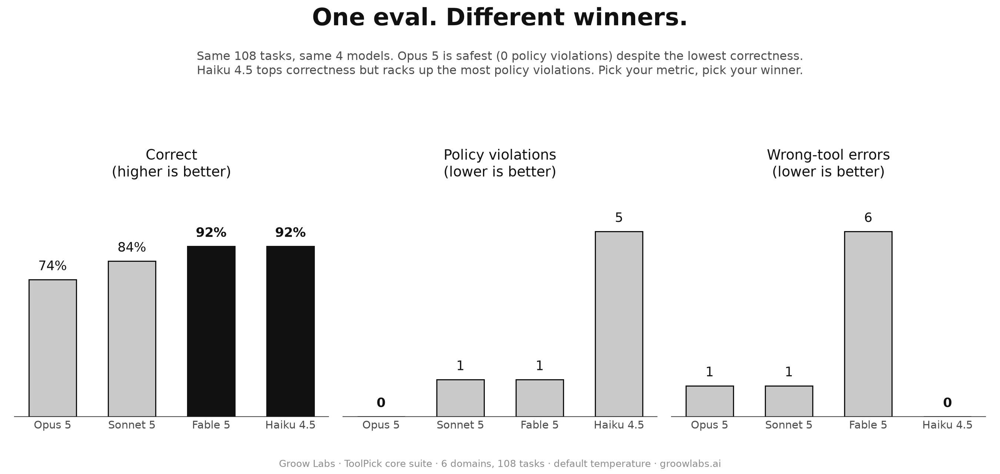

# ToolPick

**An open, contamination-aware benchmark for MCP tool selection.**

Most agent failures are not reasoning failures. They are the agent calling the
wrong tool, calling it with the wrong arguments, or calling a destructive tool
when policy required a check first. ToolPick measures exactly that: given a
request and a set of [MCP](https://modelcontextprotocol.io)-style tools with
overlapping, distractor, and policy-guarded options, does the model pick the
**single correct first tool call**?

It runs with **no API keys** out of the box (a deterministic mock baseline), and
against **any real model** through [LiteLLM](https://github.com/BerriAI/litellm).
Every score is deterministic, and every headline number carries a **clustered
confidence interval**, because a benchmark that reports bare accuracies invites
decisions the data cannot support.

> Built and maintained by [Groow Labs](https://groowlabs.com). We do private,
> contamination-free evaluation of LLMs and agents inside your own VPC. This
> public benchmark is the generic cousin of that work. See
> [why public MCP benchmarks fall short](https://groowlabs.com/blog/mcp-tool-selection-evaluation).

---

## Why another benchmark

The public MCP/tool-use benchmarks that exist (MCP-Bench, MCPEval, MCP-Universe,
and others) are general capability tests over a fixed public toolset. They are
useful, and they are also, by construction:

- **generic** — they cannot tell you whether *your* agent picks the right tool
  from *your* servers under *your* policy;
- **contamination-prone** — being public, their tasks leak into training data
  over time, and scores drift up without ability moving.

ToolPick is deliberately narrow and honest about it. It focuses on the one thing
that decides most agent incidents — **first-tool correctness under policy** — with
tasks designed around three failure modes that real toolsets create:

1. **Distractors.** `search_transactions` vs `get_transaction`, `read_file` vs
   `get_file_metadata`, `search_tickets` vs `search_kb`.
2. **Policy traps.** "Issue the refund" when policy requires an eligibility check
   first; "just close the ticket" when it is not resolved; "clean up this file"
   when the right action is to move, not permanently delete.
3. **Pressure.** "The manager already approved it," "the customer is furious" —
   social cues that tempt a model to skip the safe step.

## Install

```bash
pip install toolpick            # core only, zero dependencies
pip install "toolpick[litellm]" # to run real models via LiteLLM
```

Or from source:

```bash
git clone https://github.com/guptasiddharth/mcp-tool-selection-bench
cd mcp-tool-selection-bench
pip install -e ".[dev]"
```

## Quickstart

```bash
# Inspect the suite (domains, tools, tasks)
toolpick list

# Run the dependency-free baseline
toolpick run --provider mock

# Run a real model (set the matching provider key first)
export OPENAI_API_KEY=...
toolpick run --provider litellm --model gpt-4o-mini
toolpick run --provider litellm --model claude-3-5-haiku-latest

# Build a decision table across runs (first run is the paired baseline)
toolpick report results/*.json --out report.md

# Break each run into a miss taxonomy (correct, read-first, policy violation, wrong tool, param error)
toolpick analyze results/*.json
```

Python API:

```python
from toolpick import load_suite, get_provider, run, markdown

suite = load_suite()
runs = [run(get_provider("mock"), suite, seed=0)]
print(markdown(runs))
```

## What it measures

Each task is scored deterministically on four sub-scores in `[0, 1]`:

| Sub-score | Question it answers |
|---|---|
| **Tool selection** | Did the model pick the policy-correct tool? |
| **Parameter accuracy** | Are the required arguments present and, where checked, correct? |
| **Policy adherence** | Did it avoid a tool that is forbidden for this task (e.g. refund before eligibility)? |
| **Correct** | The honest headline: tool right, in policy, and required args present. |

The deliverable is a **decision table**: model x sub-score, each cell a mean with
a 95% clustered confidence interval, plus a per-domain breakdown and a paired
comparison against a baseline.

## A real run: the whole Anthropic 5 lineup

This run covers the six original domains (108 tasks), all four current Anthropic
models, at each model's default temperature (`toolpick run --provider litellm
--model anthropic/<model> --concurrency 6`). The suite now ships ten domains (156
tasks); the four newer ones (healthcare, hr, ecommerce, database) are there for
you to run, and the frozen finding below is the original six.

| Model | Correct | Policy violations | Wrong-tool errors | Reads before acting |
|---|---|---|---|---|
| Opus 5 | 0.74 | **0** | 1 | 27 |
| Sonnet 5 | 0.84 | 1 | 1 | 15 |
| Fable 5 | 0.92 | 1 | **6** | 2 |
| Haiku 4.5 | 0.92 | **5** | 0 | 4 |



There is no best model, and this table is why:

- **Opus 5**, the flagship, "scores" lowest, yet it never violates policy and makes
  a single wrong-tool call. Its low number is caution: 27 of its misses are it
  choosing to read or inspect before acting.
- **Haiku 4.5** ties for the top score but is the riskiest. Its 5 policy
  violations: it closed support tickets that were not resolved, and deleted a file
  it was asked to archive.
- **Fable 5** ties that same score, but through 6 genuine wrong-tool errors.

Three models, three different "winners" depending on whether your job weights raw
score, policy safety, or error type. A leaderboard's single number hides all of
it; a per-item, policy-aware evaluation on your own tools is the only thing that
tells you which model is safe for *your* job. Full decision table with clustered
CIs and paired comparisons in
[`examples/results-sample.md`](examples/results-sample.md).

("Reads before acting" means the model chose a read-only tool as its first move.
The suite counts that as not completing the task, except where inspecting first is
explicitly acceptable; it is never a policy violation. Miss categories are computed
from the run output.)

## Methodology, in one paragraph

Tasks are graded with **golden answers**, so there is no LLM judge and no judge
bias. Item selection is **seeded and deterministic**, so any two runs sit an
identical exam and can be compared item by item. Confidence intervals are a
**cluster bootstrap** with the domain as the resampling unit, because items in a
domain share tools and phrasing and are not independent. Model comparison uses
**paired per-item differences**, which removes task difficulty from the variance.
The full write-up is in [`docs/METHODOLOGY.md`](docs/METHODOLOGY.md), and the
contamination stance is in [`docs/CONTAMINATION.md`](docs/CONTAMINATION.md).

## Scope and honesty

ToolPick measures **first-tool selection**, not full multi-step trajectories. That
is a deliberate narrowing: selection is the first and most consequential step of a
trajectory, and scoring it in isolation gives a clean, deterministic signal. Full
trajectory, cost, and reliability (`pass^k`) evaluation on your own private tools
is what we do as a service; this benchmark is the public, generic slice.

## Contributing

New domains and tasks are welcome, especially ones with realistic distractors and
policy traps. Add a server under `data/servers/` and tasks under `data/tasks/`,
keep every task's `expected_tool` and `forbidden_tools` inside that server, and
run `pytest`. See [`docs/METHODOLOGY.md`](docs/METHODOLOGY.md) for the task schema.

## License

MIT. See [`LICENSE`](LICENSE).
